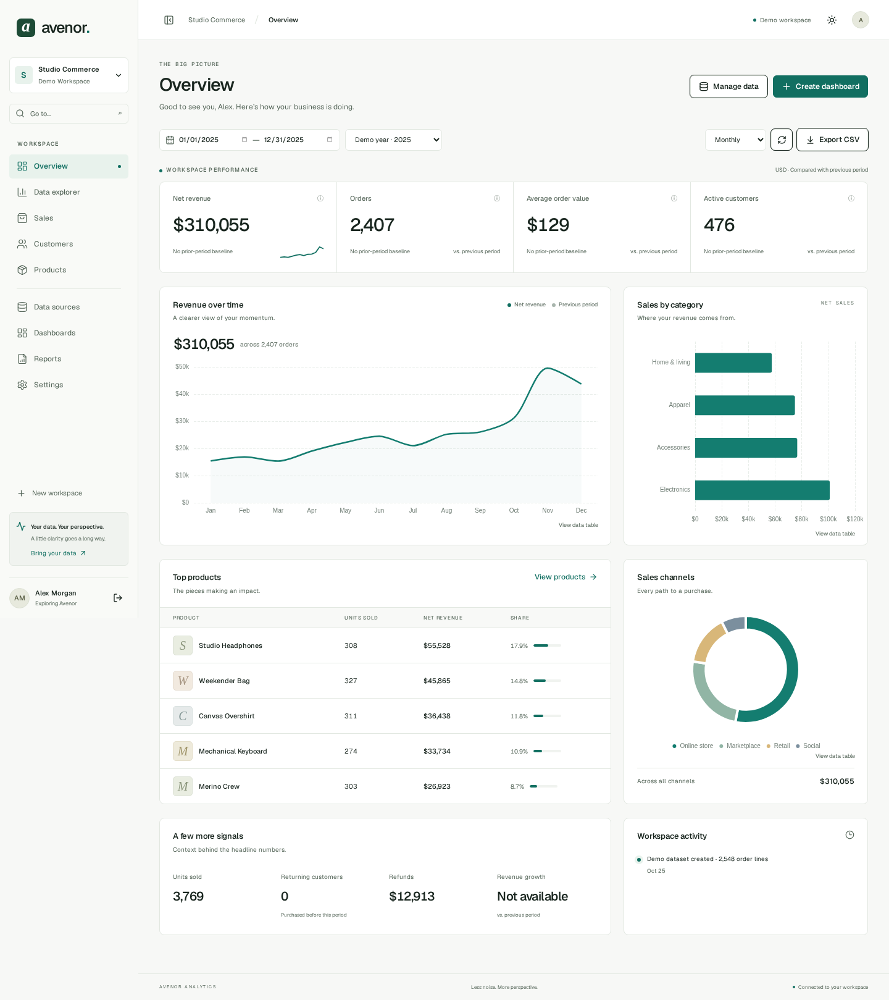

# Avenor Analytics

**Clarity in every number.** A fullstack analytics workspace for commerce data: import sales, explore real metrics, arrange dashboards, and keep reports worth returning to.



## What works

- Registration, Argon2id passwords, persistent HttpOnly cookie sessions, CSRF protection, logout, profile/password changes, and one-time password recovery through local Mailpit.
- Isolated workspaces with Owner, Admin, Editor and Viewer permissions enforced by the API.
- One-click, independent demo workspaces: 2,548 deterministic order lines across January–December 2025, including seasonality, repeat customers, discounts, cancellations and refunds. Demo reset is explicit.
- Overview, Sales, Customers and Products use the same PostgreSQL sales facts. Period comparisons, filters, server-side search/sort/pagination, column visibility, and entity detail views.
- Data explorer with validated metrics, dimensions, typed filters, bounded SQL aggregation and ECharts visualizations with accessible data tables.
- CSV/XLSX preview, column mapping, inferred types, row validation, atomic create/replace imports, duplicate prevention, private source handling, import history and error CSVs.
- Dashboard creation, rename, duplication, deletion, default selection, widget editing, mouse/keyboard drag ordering, mobile order controls, two width/height choices, notes and persisted layout. Revision checks prevent silent concurrent overwrites.
- Saved report configurations, live results, editing/deletion and CSV export. Sales exports preserve the current search, status and period.
- Light/dark/system themes, responsive navigation, local fonts, reduced motion, loading/empty/error states, and persistent account preferences.

See [implementation status](docs/implementation-status.md) for deliberate limits. This is a locally runnable initial implementation; it is not a claim that every item in the master specification is complete.

## Stack & architecture

Next.js 16 App Router, React 19, strict TypeScript, Tailwind 4, shadcn-style Radix primitives, TanStack Query/Table, React Hook Form + Zod, Apache ECharts, Motion and dnd-kit. FastAPI, Pydantic v2, async SQLAlchemy/psycopg, Alembic and PostgreSQL 17. Python dependencies are locked with uv; npm dependencies use `package-lock.json`.

The browser calls `/api/v1` on the web origin. Next.js proxies those requests to FastAPI. Backend authorization scopes every dataset, fact, dashboard and report to workspace membership. PostgreSQL stores application state; no mock API, external analytics API or paid key is required. Redis is not required for the bounded synchronous import workflow.

```text
apps/api/                  FastAPI modules, SQLAlchemy models, Alembic, pytest
apps/web/                  Next.js routes, feature UI, generated types, unit/E2E tests
packages/api-contracts/    Exported OpenAPI schema
infra/                     API and standalone web Dockerfiles
scripts/                   Installation, dev runner, contracts, browser, benchmarks
docs/                      Architecture, metrics, imports, evidence and limitations
```

## Prerequisites

- Docker Engine with Docker Compose v2.
- For native development: Node.js 24, Python 3.12 and uv 0.12.23.
- Available loopback ports: 3000 (web), 8000 (API), 5432 (PostgreSQL), 1025/8025 (SMTP/Mailpit).

The environment already supplies an isolated checkout. Use it directly; no extra worktree is needed.

## Start with Docker

From the repository root:

```bash
cp .env.example .env
docker compose up --build -d --wait
```

Open `http://localhost:3000` on your local machine. Select **Try the live demo**; there are no shared demo credentials. Each click creates a separate demo user and workspace. Alternatively register, create a workspace, then use **Data sources → Load demo data** or import [the sample CSV](apps/web/public/sample-sales.csv).

API docs: `http://localhost:8000/docs`. Health: `http://localhost:8000/api/v1/health`. Local reset emails: `http://localhost:8025`.

`docker compose stop` stops services. PostgreSQL persists in the named `postgres-data` volume. Do not use `docker compose down -v` unless you intend to delete all local database data.

The web image bakes its API destination at build time (`API_URL`, default `http://api:8000`). Rebuild the image if that destination changes. `APP_ORIGIN` must equal the browser origin; use a real HTTPS origin and `COOKIE_SECURE=true` for HTTPS deployment. The included database password is for local development only. See [cloud networking notes](docs/architecture.md#cloud-builds).

## Native development

```bash
cp .env.example .env
./scripts/install.sh
python scripts/dev.py
```

The installer runs frozen dependency installs, starts PostgreSQL/Mailpit, waits for them, and applies migrations. It does not regenerate tracked source or lockfiles. The dev runner starts both services and stops their process groups on Ctrl+C. When switching from a running Docker stack, stop its application containers first with `docker compose stop api web` to free the same ports.

Or run them in separate terminals:

```bash
# Terminal 1, apps/api
uv run --frozen uvicorn app.main:app --reload --port 8000
# Terminal 2, apps/web
npm run dev
```

`DATABASE_URL`, `APP_ORIGIN`, `COOKIE_SECURE`, `SMTP_HOST` and `SMTP_PORT` configure the API. `API_URL` configures the web proxy. Defaults work locally. A root `.env` is read by the API; use process variables for a non-default native web `API_URL`.

## Database & migrations

```bash
cd apps/api
uv run alembic upgrade head
```

The application does not create tables on startup; Docker explicitly runs migrations first. Migration upgrade → downgrade → upgrade has been exercised against a separate empty PostgreSQL database. Demo data is generated on demand through the authenticated API.

## Validation

```bash
# Prepare a separate test database (names must end in _test).
cd apps/api
uv run python ../../scripts/create-test-db.py
uv run ruff check .
uv run ruff format --check .
uv run mypy app
uv run pytest -q

# Frontend
cd ../web
npm run typecheck
npm run lint
npm test
npm run build
```

Backend integration tests require PostgreSQL and Mailpit. They truncate **only the explicitly designated test database**, never the development database. Default: `avenor_test`; override with `TEST_DATABASE_URL` ending in `_test`. Never point tests at a database containing valuable data.

With web and API running, from the root:

```bash
node scripts/prepare-browser.mjs
cd apps/web
npm run test:e2e
```

The browser helper unpacks the locked `@sparticuz/chromium` development package, useful when the environment blocks Playwright's download CDN. It needs a compatible Linux x86-64 environment. On other platforms, use `npx playwright install chromium`; omit `.data/browser-path` or set `PW_CHROMIUM_PATH` to a compatible installed Chromium. The tests default to `http://localhost:3000`.

Tests cover real browser registration, demo analytics, search/filtering, dashboard edit/resize/persistence, CSV mapping/import, saved reports/export, theme persistence, mobile navigation and overflow checks at 360/390/768/1024/1440/1920 px. Axe checks exercise light and dark Overview. Screenshots are real captures, not fixture data. See [validation evidence](docs/validation.md).

## API contracts

After changing Pydantic schemas:

```bash
cd apps/api
uv run python ../../scripts/export-contracts.py
cd ../web
npm run contracts
npm run typecheck
```

Commit the schema and generated TypeScript together. GitHub Actions checks contract drift, backend/frontend checks, production build and browser workflows; the workflow itself is supplied but has not been run on GitHub.

## Measured performance

Run `apps/api/.venv/bin/python scripts/benchmark.py` with the native API running to import and verify 10,000 and 100,000 rows. It uses isolated benchmark workspaces and deletes their imported datasets afterward. Actual timings and environment are in [benchmark.json](docs/benchmark.json); these are local observations, not a throughput guarantee.

## Screenshots & design

[Light desktop](docs/screenshots/overview-1440-light.png) · [Dark desktop](docs/screenshots/overview-1440-dark.png) · [Mobile](docs/screenshots/overview-390-light.png) · [Landing](docs/screenshots/landing.png)

A restrained forest-green/neutral palette, Geist typography, tabular figures, compact controls, direct labels and low-motion interaction. Large datasets stay on the server; heavy chart code loads only when needed.

## Local Git history

Development uses Conventional Commits. No changes are pushed automatically. Local commits live in this checkout's `.git`; push or export a Git bundle yourself when you want an independent copy. Do not rely on a cloud configuration save alone as proof that local-only commits will restore in another task.
